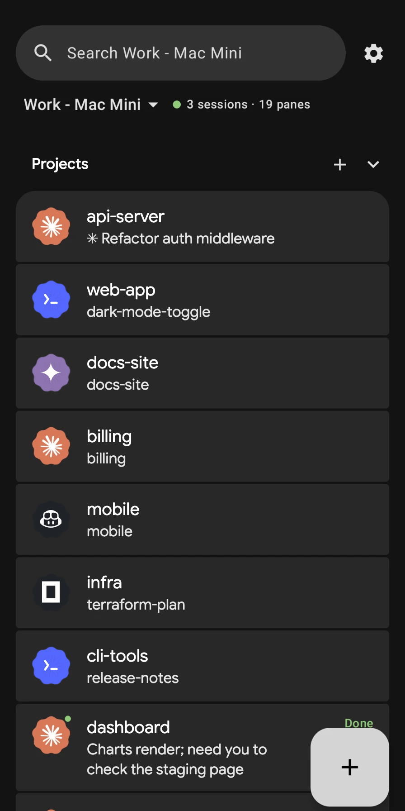
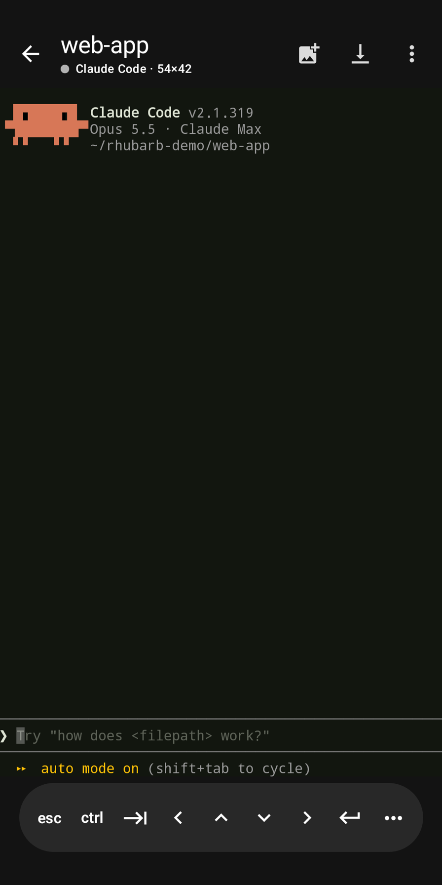
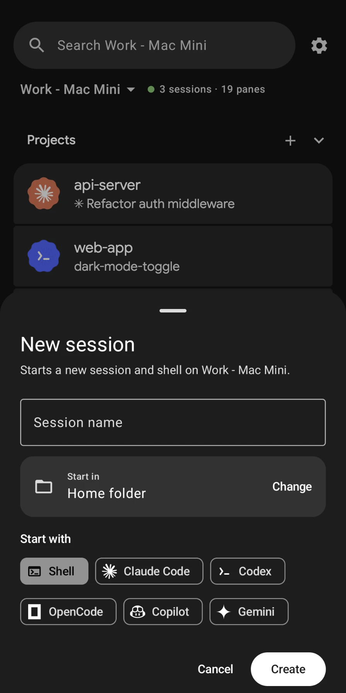
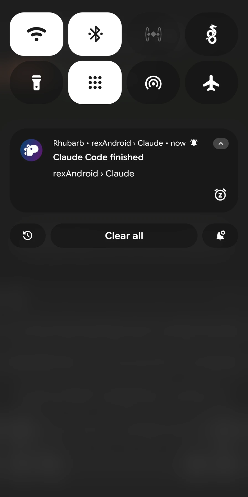

# Rhubarb: an unofficial Android client for Rex

An Android companion for [Rex](https://www.superlogical.com/), the terminal multiplexer from
Superlogical. Superlogical ships macOS (and is working on iOS); this app is an independent,
unofficial client built on the API that every Rex server documents about itself at
`GET /llms.txt`. Rhubarb collects no data; see the [privacy policy](https://jwise.dev/rhubarb/privacy/).

> **Built with AI assistance.** Rhubarb was developed by Josh Wise with the help of AI coding
> tools (Claude Code by Anthropic). Josh directed the work and tested each change on real devices
> against a real Rex server; the AI wrote much of the code under that direction.

| Sessions | Terminal | New session | Alerts |
| :---: | :---: | :---: | :---: |
|  |  |  |  |

## Get it

Rhubarb is in a closed test on Google Play ahead of its public release. To join:

1. Join the [tester group](https://groups.google.com/a/jwise.dev/g/rhubarb-testers) with the Google account on your phone.
2. [Opt in to the test](https://play.google.com/apps/testing/dev.jwise.rhubarb).
3. [Install from Google Play](https://play.google.com/store/apps/details?id=dev.jwise.rhubarb).

Or download the APK from [Releases](https://github.com/Joshua-Wise/rhubarb/releases/latest). Play and
GitHub builds are signed differently and can't update each other, so stick with one.

## What it does

- **Sessions at a glance**: every session, window, and terminal on your Mac, with each
  terminal's title, directory, and live program status.
- **Start and manage work from the phone**: the + button starts a new session, and the + on a
  session adds a tab (without switching the Mac to it). Choose the folder to start in (browsed on
  the Mac) and what to start: a shell, Claude Code, Codex, OpenCode, Copilot or Gemini. Hold a pane
  to rename, reorder, share its output, clear it or close its tab; hold a session's header to
  rename, reorder or end it. Panes running coding agents show the agent's mark (Claude Code,
  Codex, Gemini, Copilot, OpenCode, Cursor, Qwen, Mistral, Ollama; most marks from Simple Icons).
- **In a pane**: ⋮ shares the screen and scrollback as text (a .txt file when it's long), clears
  the screen, or resets the terminal.
- **Settings** shows the Rex server's version and Tailscale name. Hold a saved host to forget it.
- **"Needs you" alerts**: programs report status with OSC 7501, and Claude Code does. When
  one goes `blocked` (permission, question, or password), you get a high-priority notification
  with a **Reply** action that types into the terminal. You can also be told when work goes
  `working` → `done`, and you get OSC 9/777 desktop notifications from programs.
- **Live terminal**: watch any pane in real time (Ghostty, or xterm.js as a fallback), type
  with a phone-friendly key bar (Esc, sticky Ctrl/Alt/Shift, Tab, arrows that repeat, hold
  Ctrl for common chords, hold Enter for a new line that isn't sent), paste, long-press to
  copy, and long-press a link to open, copy or share it. Panes fit the phone while open and get the Mac's size back when you leave
  (Settings → Terminal → Fit panes to phone turns this off and shows the Mac's grid with zoom).
  If the Mac takes a pane while it's open on the phone, the phone lets it go and returns to
  the pane list.
- **Send images to the Mac**: the image button in a pane (or Paste with an image copied, or an
  image from the keyboard) sends pictures to the pane's machine. Rex saves them and types their
  paths into the terminal, so you can hand Claude Code a screenshot. Needs a Rex server with
  API revision 11.

## How it connects

```
Android device ──Tailscale (WireGuard)──▶ <mac>-rex.<tailnet>.ts.net (HTTPS, built into the Rex server)
                  ├─ wss /api/control   JSON: requests, responses, events  (rex.control.v1)
                  ├─ wss /api/data      binary: one terminal's output stream (rex.data.terminal.v1)
                  └─ wss /api/data      binary: an image being sent to the Mac (rex.data.bytes.v1)
```

The Rex server runs its own Tailscale node. It accepts connections from devices signed in to
the **same Tailscale login** and identifies them by that login, so the app needs no password
or token. Turn it on from the Mac with `rex server tailscale on`. `rex server status` prints
the address.

### Renderers

Panes are drawn by **Ghostty** by default: Ghostty's VT core (`native/`, built with Zig into
`librexterm.so`) behind a JNI bridge and Compose canvas adapted from
[chuchu](https://github.com/jossephus/chuchu) (MIT). Rex's terminal stream is fed straight into it;
replies Ghostty would send to the program are dropped (the Mac's terminal already answers), while
wheel input from scroll gestures is forwarded. Settings → Terminal → Renderer switches back to
xterm.js.

Build the native library before the app (needs Zig 0.17 and the Android NDK):

```sh
ZIG=/path/to/zig ANDROID_NDK_HOME=/path/to/ndk scripts/build-native.sh
```

### Rendering note

A terminal's data stream begins with a binary Ghostty snapshot (`GHOSTSNP`) that only
Ghostty-based emulators can read. The server always sends a nonce-tagged
`ESC _ rex1;<nonce>;{"type":"resize",…} ESC \` right after it. The app drops everything
before that marker, seeds xterm.js with `com.superlogical.terminal.format {format:"vt"}`, and
then streams raw VT output. Output that arrives while that seed call is in flight is dropped,
so the first frame can be slightly off. Programs that redraw, like Claude Code and vim, correct
it right away. Embedding `libghostty-vt` would make the seed exact.

## Build

Requirements: JDK 17 and the Android SDK (platform 37). The toolchain is AGP 9.5, Gradle 9.8,
Compose BOM 2026.09 and Material3 1.5 (for the M3 Expressive components).

Build output goes to `~/Library/Caches/rexAndroid/`, not `app/build/`. `~/Documents` syncs to
iCloud Drive, which drops "file 2.class" duplicates into build folders and breaks R8.

```sh
brew install openjdk@17 && brew install --cask android-commandlinetools
export JAVA_HOME=/opt/homebrew/opt/openjdk@17
export ANDROID_HOME=/opt/homebrew/share/android-commandlinetools
sdkmanager --licenses
sdkmanager "platform-tools" "platforms;android-37.0"
./gradlew assembleDebug
adb install -r ~/Library/Caches/rexAndroid/app/outputs/apk/debug/app-debug.apk
```

## Phone setup

1. Install Tailscale on your Android device and sign in with the same account as the Mac.
2. Open Rhubarb and enter the server address, for example `my-mac-rex.tailnet.ts.net`.
3. Optional: turn on **Watch in background** to get alerts while the app is closed. This
   keeps a foreground-service connection open, because Rex has no push channel to phones.

## Layout

```
app/src/main/java/dev/jwise/rhubarb/
  rex/RexControl.kt      control WebSocket: hello/welcome, requests, events, reconnect token
  rex/TerminalStream.kt  data WebSocket: ticket HELLO, RESUME w/ exact byte count, APC parsing
  rex/RexHub.kt          live model: sessions, views, titles, program statuses
  service/Notifier.kt    events -> notifications (+ Reply action)
  service/WatchService.kt foreground service keeping the connection alive
  ui/                    Compose screens (server setup, home, terminal)
app/src/main/assets/term/ xterm.js 5.5.0 (MIT) host page
```

## License

[MIT](LICENSE). Bundled third-party pieces keep their own licenses: Ghostty's terminal engine
and xterm.js are MIT, and the agent marks come from Simple Icons (CC0; the Copilot mark is MIT).
